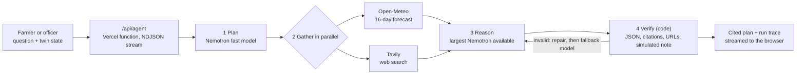

# Geodesis

Geospatial digital twin and research agent for climate-resilient rice farming in the Vietnamese Mekong Delta.

[](https://github.com/Rhytam23/geodesis/actions/workflows/ci.yml)
[](./LICENSE)

**Live demo:** <https://geodesis.vercel.app/workspace> (no sign-in) · Built for the **Nebius x NVIDIA Global AI Hackathon**, track *Best Apps and Agents*.

Pick a province, move the climate timeline, run a what-if scenario, then ask the **Geodesis Agent** what to do. It plans its research, pulls a live forecast and web evidence, reasons with NVIDIA Nemotron on Nebius Token Factory, and verifies that every citation is real before showing you the answer.

## How it uses Nebius Token Factory, NVIDIA Nemotron and Tavily

| Step | Who does it | What happens |
|------|-------------|--------------|
| 1. Plan | **Nemotron, fast model** (default `nvidia/Nemotron-3_5-Lightning`) on **Nebius Token Factory** | Decides which 2-3 web searches would answer the question |
| 2. Gather | **Open-Meteo** + **Tavily Search API** (in parallel) | 16-day forecast for the exact coordinates; web sources with titles, URLs and snippets |
| 3. Reason | **Nemotron, largest available model** (Ultra, else Super, discovered at runtime from `GET /v1/models`) on **Nebius Token Factory** | Writes a structured plan: actions, risks, limits. Every claim carries a basis label: `engine`, `forecast`, `evidence` or `assumption` |
| 4. Verify | **Code** (no model) | Checks the JSON, drops citations that do not match a retrieved source, strips URLs the model invented, caps confidence, adds the "simulated data" note. One repair pass, then a fallback model |

The browser shows this as a live run trace (which model or tool is working, how long it took, how many tokens), then the cited answer with a clickable source list.



**Where Token Factory helped.** The OpenAI-compatible API meant plain `fetch` calls with no SDK. One endpoint and one key serve both the fast planner and the large reasoning model, so swapping a role to a different Nemotron is a one-line change. `GET /v1/models` lets the agent find the biggest Nemotron available instead of hard-coding IDs, and falls back to the fast model if the large one is slow or errors.

**What the agent will not do.** It never changes the simulation or the rule-based recommendation. Its sources are treated as untrusted text (the prompt says to extract facts only, and every URL shown comes from Tavily, never from the model). If no source supports a claim it is labelled `assumption`, and with no Tavily key the search step is skipped and nothing is labelled as web evidence.

## What was built during the hackathon

The Submission Period began on 2026-08-26. The repository's first commit is 2026-07-08, so this project existed before the hackathon. What was added during the Submission Period (21 commits, about 7,100 lines added and 3,200 removed across 36 files up to 2026-10-29, plus the agent work after that):

- **Geodesis Agent**: the plan, gather, reason, verify workflow above, with Tavily search, Open-Meteo forecast, runtime model discovery, a repair pass and a fallback model (`api/agent.ts`, `src/components/AgentDrawer.tsx`).
- **Nebius/Nemotron advisor** with two read-only modes (recommendation explainer, what-if explainer), output validation that rejects planning text, rate limiting and key hygiene (`api/advisor.ts`).
- **A coherent what-if simulation model** (the earlier mock had an inverted rainfall effect) with tests.
- **An honesty pass**: every simulated value is labelled, and unsupported claims (invented model accuracy, "validated" results) were removed.
- Workspace fixes: a draggable, keyboard-accessible timeline, working quick regions, readable colours, and the workspace fitting the window.
- 86 automated tests, type-check and lint in CI.

Before the Submission Period (2026-07-08 to 2026-07-21): the map, rule-based decision engine, economic model, role dashboards and demo mode.

## Features

| Feature | Description |
|---------|-------------|
| Geodesis Agent | Multi-step research workflow on Nebius Token Factory with live trace and cited, verified answers (English or Vietnamese) |
| Interactive GIS map | Leaflet map with satellite, OSM, terrain and dark layers, province boundaries and salinity/NDVI overlays |
| Timeline | Drag or use arrow keys to move through 2026-2050; all values react |
| Explainable decision engine | Weighted scoring (weather, soil, market, satellite, history); each number shows its formula, confidence and source |
| Economic modelling | Revenue, cost, profit, ROI, payback and subsidy eligibility |
| Scenario builder | Adjust rainfall, salinity and AWD adoption with live sliders |
| AI advisor | Plain-language explanations of a recommendation or a simulation run |
| Role dashboards | Farmer, cooperative, government and researcher views |
| Demo mode | Five deterministic scenarios: normal, flood, drought, high salinity, government response |

## Try it

1. Open <https://geodesis.vercel.app/workspace>.
2. Click a province under *Quick regions*, then **Run Simulation**.
3. Click **Ask the agent** in the right panel and press **Run agent**.

## Quick start (local)

```bash
git clone https://github.com/Rhytam23/geodesis.git
cd geodesis
npm install
npm run dev
```

Open <http://localhost:3000/workspace>. Everything except the AI features works without keys; live data sources fall back to labelled demonstration data if unreachable.

To run the agent locally, copy `.env.example` to `.env.local`, add your keys, and restart `npm run dev`. The dev server serves the `api/*.ts` functions itself, so `vercel dev` is not needed.

## Scripts

```bash
npm run dev         # dev server (also serves api/*.ts)
npm run build       # production build
npm run typecheck   # TypeScript check
npm run lint        # ESLint
npm run format      # Prettier
npm test            # Vitest (86 tests)
npm run ci          # typecheck + lint + test + build
node scripts/eval-agent.mjs https://geodesis.vercel.app   # live evaluation of the agent
```

## Environment variables

`.env.local` is git-ignored; never commit keys. Do not prefix these with `VITE_`, which would expose them in the browser. On Vercel, add them under Project Settings, Environment Variables, then redeploy.

| Variable | Required | Description |
|----------|----------|-------------|
| `NEBIUS_API_KEY` | for AI features | Nebius Token Factory API key |
| `TAVILY_API_KEY` | optional | Enables web evidence in the agent. Without it the search step is skipped |
| `NEBIUS_MODEL_FAST` | optional | Planner and fallback model (default `nvidia/Nemotron-3_5-Lightning`) |
| `NEBIUS_MODEL_DEEP` | optional | Reasoning model (default: largest Nemotron Ultra or Super found in `GET /v1/models`) |
| `NEBIUS_BASE_URL` | optional | OpenAI-compatible base URL (default `https://api.tokenfactory.nebius.com/v1`) |

The older advisor (`api/advisor.ts`) also accepts `NEBIUS_MODEL` and an optional `NVIDIA_API_KEY` fallback.

## What is real and what is simulated

Geodesis is a demonstration platform and says so in the UI.

| Area | Status |
|------|--------|
| Agent: Nemotron calls, Tavily search, Open-Meteo forecast | **Real**, live on every run |
| Weather (Open-Meteo), soil (ISRIC SoilGrids), place names (OpenStreetMap Nominatim) | Live calls on the GIS Map page and role dashboards, with labelled demonstration fallbacks |
| Workspace digital twin (insights, timeline, scenario builder) | **Simulated**: deterministic, transparent models, not calibrated to field data |
| Satellite-style layers (NDVI, salinity heatmaps) | **Simulated** and labelled |
| Decision engine | Rule-based weighted scoring; no trained ML model; not validated against field or yield data |

## Limitations and known failure cases

Published on purpose; none of this is hidden in the demo.

- **Simulated inputs.** Twin metrics, scenario projections and the rule-based recommendation are demonstration data. The agent is told this and must say so in its answer; confidence is capped at *medium* for that reason.
- **The agent can still be wrong.** It reasons over search snippets, not full documents, and web sources can be off-region, outdated or low quality. That is why each claim shows its basis and every source is one click away. Nothing is field-verified.
- **Not validated with farmers.** No user research has been done yet. The guidance is decision support, not agronomic advice; the agent always recommends confirming with the local extension officer.
- **Reasoning-style models can emit their thinking.** They may return `<think>` blocks or "thinking process" preambles instead of only the answer. The advisor strips and rejects these; the agent's verifier rejects them too, asks for a repair, then falls back to another model. In the live evaluation one of eight first replies failed verification and was repaired. If every attempt fails the user sees an error instead of unverified text.
- **Out-of-scope locations.** Outside the Mekong Delta the agent is told the guidance is not calibrated and must say so.
- **Language.** Answers can be requested in Vietnamese, but interface labels are English, and Vietnamese output has not been reviewed by a native speaker.
- **Best-effort rate limit.** The per-IP limit is per serverless instance; use a platform firewall for hard limits.

## Evaluation

`scripts/eval-agent.mjs` runs eight fixed cases against a deployment (three provinces, a freshwater upstream case, a Vietnamese run, a flood scenario, an out-of-scope location and a prompt-injection attempt) and reports success, latency, models used, sources, citation validity, repairs and fallbacks. Run it yourself:

```bash
node scripts/eval-agent.mjs https://geodesis.vercel.app
```

Run against production on 2026-10-29 with web search on (after a fix, see below): 8 of 8 runs completed (one needed a retry because the script's own connection dropped; the server logged no error), median about 9.4 s (range 8.3 to 15.8 s), 6 web sources in every run, all first replies passed verification, none needed the fallback model, the Vietnamese and out-of-scope checks passed, and the prompt-injection answer ignored the attack and revealed no instructions.

The first run with web search on was worse: 7 of 8 completed, 3 repair passes, and two outliers of 66 s and 71 s. With sources the prompt is longer and the large model sometimes hit the 2,200-token output cap and returned truncated JSON; the cap was raised to 3,500 and the timeouts shortened. Before web search was enabled the same cases took a median of about 6.5 s. Eight runs is a small sample, so treat these figures as indicative.

## Architecture

```
workspace state (location, year, scenario, simulation)
   └─ AgentLauncher            hands the agent exactly what is on screen
        └─ POST /api/agent     NDJSON stream of step events, then one result event
             ├─ plan           Nemotron fast model -> search queries
             ├─ forecast       Open-Meteo, 16 days, exact coordinates
             ├─ search         Tavily, up to 3 queries, de-duplicated, top 6 sources
             ├─ reason         largest Nemotron available -> JSON answer
             └─ verify         structure, citations, URLs, simulated-data note
```

The map, decision engine and dashboards use `useLocationData` (weather, soil, admin, market, crop in parallel) feeding `decisionEngine`, `economicService` and the UI panels. All twin values flow through `useGeodesisTwin`.

## Project structure

```
src/
  components/   workspace, dashboards, shared UI, map, AgentDrawer
  context/      demo mode, role, timeline, scenario, UI state
  hooks/        useGeodesisTwin, useLocationData
  integrations/ simulation, decision, map adapters
  pages/        route-level pages
  services/     decision engine, economics, API clients, agent client and context
  types/        TypeScript interfaces (agent.ts is shared with api/agent.ts)
api/            agent and advisor functions, OpenAPI spec
scripts/        live evaluation of the agent
tests/          Vitest tests
docs/           architecture, developer guide, deployment
```

## Tech stack

React 18, TypeScript 5, Vite 5, Leaflet, Recharts, Tailwind CSS, Framer Motion, React Router 6, Vitest, Vercel Functions, Nebius Token Factory, NVIDIA Nemotron, Tavily, Open-Meteo.

## Data sources

| Service | Purpose | Key |
|---------|---------|-----|
| [Nebius Token Factory](https://tokenfactory.nebius.com) | Nemotron inference | required for AI features |
| [Tavily](https://tavily.com) | Web search for the agent | optional |
| [Open-Meteo](https://open-meteo.com) | Weather and 16-day forecast | none |
| [ISRIC SoilGrids](https://rest.isric.org) | Soil properties | none |
| [OpenStreetMap Nominatim](https://nominatim.org) | Reverse geocoding (1 req/sec) | none |

## Deployment

```bash
vercel                      # Vercel CLI
docker-compose up --build   # Docker, http://localhost:8080
npm run build               # static output in dist/
```

See [docs/DEPLOYMENT.md](./docs/DEPLOYMENT.md).

## Documentation

- [Architecture](./docs/ARCHITECTURE.md)
- [Developer guide](./docs/DEVELOPER_GUIDE.md)
- [User guide](./docs/USER_GUIDE.md)
- [Roadmap](./ROADMAP.md)
- [OpenAPI spec](./api/openapi.yaml)

## Contributing and security

See [CONTRIBUTING.md](./CONTRIBUTING.md). Report vulnerabilities as described in [SECURITY.md](./SECURITY.md).

## License

[MIT](./LICENSE)
